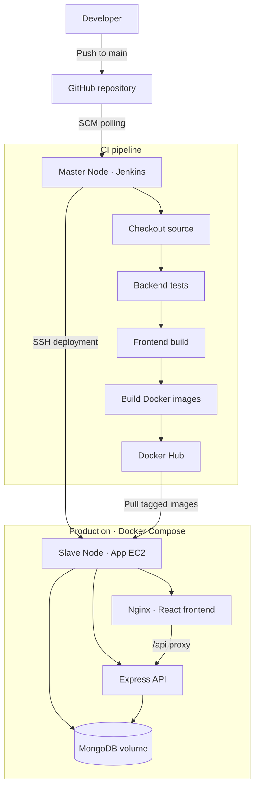

<div align="center">
  

  <h1>NotesHub - Jenkins CI/CD</h1>

  <p><strong>A full-stack notes application with an automated AWS delivery workflow.</strong></p>
  <p>React · Node.js · MongoDB · Docker · Terraform · Ansible · Jenkins</p>

  <p>
    
    
    
    
  </p>
  <p>
    
    
    
    
  </p>

  <p>
    <a href="https://github.com/tanahmeeedsx/jenkins-ci-cd">Repository</a>
    &nbsp;·&nbsp;
    <a href="https://github.com/tanahmeeedsx/jenkins-ci-cd/issues">Issues</a>
  </p>
</div>

---

## Overview

NotesHub is a full-stack notes application paired with an AWS-based DevOps workflow. It demonstrates application development, containerization, infrastructure provisioning, configuration management, and continuous delivery using a two-node EC2 architecture.

## Application Features

- User registration and login with bcrypt password hashing and JWT authentication.
- Create, edit, and delete notes.
- Search notes by title or content.
- Organize notes with categories.
- Pin important notes and archive completed ones.
- Persist application data in MongoDB.

## Technology Stack

| Layer | Technologies |
|---|---|
| Frontend | React 19, Vite, Nginx |
| Backend | Node.js 22, Express 5 |
| Database | MongoDB 8, Mongoose |
| Authentication | JWT, bcrypt |
| Containers | Docker, Docker Compose |
| Infrastructure | AWS VPC, EC2, Security Groups |
| Infrastructure as Code | Terraform |
| Configuration Management | Ansible |
| CI/CD | Jenkins |
| Container Registry | Docker Hub |

## Architecture

The project uses two EC2 nodes. The **Master Node** hosts Jenkins and performs the CI pipeline, Docker image build, and registry publishing. The **Slave Node** is the application deployment host and runs the production Docker Compose stack. In this project, Slave refers to the application host; it is not currently registered as a Jenkins build agent.



## AWS Infrastructure

Terraform provisions the infrastructure in **US West (Oregon), `us-west-2`**.

| EC2 node | Role | Instance type | Root volume |
|---|---|---:|---:|
| `noteshub-master-node` | Jenkins Controller | `c7i-flex.large` | 20 GB gp3 |
| `noteshub-slave-node` | NotesHub application host | `t3.small` | 20 GB gp3 |

The network consists of a dedicated VPC (`10.20.0.0/16`), public subnet (`10.20.1.0/24`), Internet Gateway, public route table, and separate security groups.

### Network access

| Node | Port | Purpose | Allowed source |
|---|---:|---|---|
| Master | 22 | SSH | Administrator CIDR |
| Master | 8080 | Jenkins UI | Administrator CIDR |
| Slave | 22 | SSH | Administrator CIDR and Master security group |
| Slave | 80 | NotesHub frontend | Public HTTP |

MongoDB and the backend port are not exposed directly to the public internet.

## CI/CD Pipeline

The repository `Jenkinsfile` defines the automated delivery stages:

1. Checkout the `main` branch.
2. Install backend dependencies and run automated API tests.
3. Install frontend dependencies and create a production Vite build.
4. Build backend and frontend Docker images.
5. Authenticate to Docker Hub and push images tagged with the Jenkins build number.
6. Connect to the application EC2 over SSH, copy the production Compose configuration, pull the new images, and run the API health check.

The Jenkinsfile uses SCM polling every five minutes. The Jenkins job should use **Pipeline script from SCM** with the repository's `Jenkinsfile`.

## Repository Structure

```text
.
├── app/
│   ├── backend/
│   │   ├── middleware/
│   │   ├── models/
│   │   ├── routes/
│   │   └── tests/
│   └── frontend/
│       └── src/
├── deployment/
│   ├── deploy.sh
│   └── docker-compose.prod.yml
├── docs/
│   └── assets/
│       └── jenkins-logo.svg
├── infrastructure/
│   ├── ansible/
│   │   ├── inventory/
│   │   └── playbooks/
│   └── terraform/
├── Jenkinsfile
├── docker-compose.yml
└── README.md
```

## Run Locally

### Prerequisites

- Node.js 22 and npm
- Docker Engine and Docker Compose

### Start the application

From the repository root:

```bash
cp .env.example .env
```

Generate a strong secret and put it in the local `.env` file:

```bash
openssl rand -hex 32
```

Then build and start the services:

```bash
docker compose up -d --build
docker compose ps
```

Open the frontend at `http://localhost:8082`. The backend health endpoint is `http://localhost:5001/api/health`.

View logs:

```bash
docker compose logs -f
```

Stop containers without deleting the MongoDB volume:

```bash
docker compose down
```

Do not use `docker compose down -v` unless you intentionally want to delete the database volume.

## Provision Infrastructure with Terraform

1. Configure AWS CLI credentials with access to `us-west-2`.
2. Use an EC2 key pair that already exists in that region.
3. From `infrastructure/terraform`, create the local variables file:

```bash
cp terraform.tfvars.example terraform.tfvars
```

4. Set the key pair name and your current public IP in `terraform.tfvars`. Use a single-host CIDR such as `203.0.113.10/32` for administrator access.
5. Initialize, validate, review, and apply:

```bash
terraform init
terraform fmt -recursive
terraform validate
terraform plan
terraform apply
terraform output
```

Review the Terraform plan and AWS charges before applying. EC2, EBS, and public IPv4 charges may apply while resources are provisioned.

## Configure Nodes with Ansible

Create a local inventory from the example:

```bash
cd infrastructure/ansible
cp inventory/inventory.ini.example inventory/inventory.ini
```

Set both EC2 public IPs and the private-key path in `inventory/inventory.ini`. Then test access and configure the nodes:

```bash
ansible all -m ping
ansible-playbook playbooks/site.yml
```

The playbook installs Java 21, Jenkins LTS, Docker, Node.js 22, and Git on the Master Node. It installs Docker, Docker Compose, and Git on the Slave Node, then prompts for a JWT secret to create the protected application `.env` file.

## Configure Jenkins

Open the Jenkins URL from `terraform output`, complete the initial setup, and ensure the Pipeline, Git, Credentials Binding, and SSH Agent plugins are available.

Create these credentials under **Manage Jenkins → Credentials → System → Global credentials**:

| Credential ID | Type | Value |
|---|---|---|
| `dockerhub-credentials` | Username with password | Docker Hub username and access token |
| `app-server-ssh` | SSH Username with private key | `ubuntu` and the EC2 private key |
| `app-server-host` | Secret text | Slave Node public IP |

Create Docker Hub repositories named `noteshub-backend` and `noteshub-frontend`.

Create a Jenkins **Pipeline** job using **Pipeline script from SCM**:

- SCM: Git
- Repository URL: `https://github.com/tanahmeeedsx/jenkins-ci-cd.git`
- Branch: `*/main`
- Script path: `Jenkinsfile`

Before the first automated deployment, Ansible must create `/home/ubuntu/noteshub/.env` on the Slave Node with a valid `JWT_SECRET`.

## Problems and Solutions

| Issue | Cause | Resolution |
|---|---|---|
| Jenkins APT repository reports `NO_PUBKEY` | The repository signing key was outdated | Download the current Jenkins LTS signing key and configure the repository with its matching `signed-by` path |
| Ansible SSH connection times out | The ISP-assigned public IP changed but the Security Group still allowed the previous IP | Update `allowed_ssh_cidr` in local `terraform.tfvars` and apply the Security Group change |
| Docker returns permission denied | The SSH session had not picked up new Docker group membership | Reconnect after adding the user to the `docker` group |
| Jenkins cannot access Docker | Jenkins service user was not in the Docker group | Add `jenkins` to the group and restart Jenkins |

## Security and Operations

- Keep `.env`, `terraform.tfvars`, Terraform state, plan files, SSH keys, and registry tokens out of Git.
- Store Docker Hub and SSH credentials in Jenkins Credentials.
- Restrict SSH and Jenkins UI access to trusted administrator IPs.
- Keep MongoDB and the backend port private.
- Docker group membership grants powerful host-level access; limit it to trusted users and services.
- Back up the MongoDB volume before replacing or destroying the application EC2.
- Update the administrator CIDR when a dynamic public IP changes.

## Cleanup

Back up any application data you need before destroying infrastructure. From `infrastructure/terraform`, review the destroy plan and then remove the provisioned resources:

```bash
terraform plan -destroy
terraform destroy
```

Destroying the application EC2 also removes its local MongoDB volume and application data.

## Attribution

The Jenkins logo is the official project artwork from the [Jenkins project](https://www.jenkins.io/). The artwork is distributed under the Creative Commons Attribution-ShareAlike 3.0 Unported License. See the [Jenkins artwork guidelines](https://www.jenkins.io/artwork/) for details.
