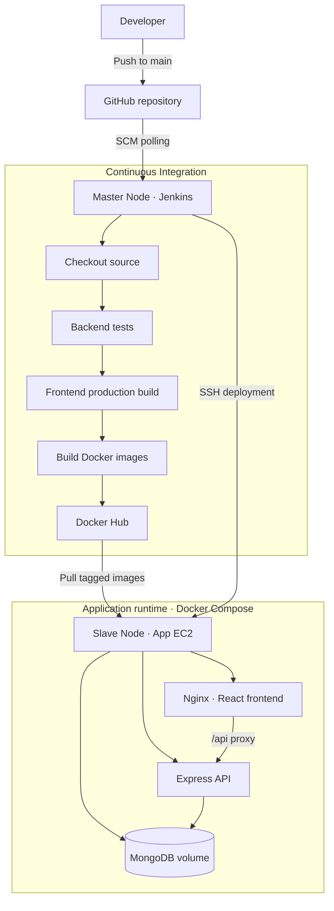

<div align="center">
  

  <h1>NotesHub</h1>

  <p><strong>A clean, full-stack space to capture, organize, and find your notes.</strong></p>
  <p>Built with React, Node.js, MongoDB and delivered through an AWS-based DevOps workflow.</p>

  <p>
    
    
    
    
  </p>
  <p>
    
    
    
    
  </p>

  <p>
    <a href="https://github.com/tanahmeeedsx/jenkins-ci-cd">Repository</a>
    &nbsp;·&nbsp;
    <a href="https://github.com/tanahmeeedsx/jenkins-ci-cd/issues">Issues</a>
  </p>
</div>

---

## Overview

NotesHub is a full-stack notes application paired with an infrastructure and delivery workflow. The application provides a simple place to write and manage personal notes, while the repository demonstrates how the application can be packaged, tested, provisioned, and deployed with common DevOps tools.

### Application features

- Register and sign in with password hashing and JWT authentication.
- Create, edit, and delete notes.
- Search notes by title or content.
- Organize notes with categories.
- Pin important notes and archive completed ones.
- Persist application data in MongoDB.

## Technology stack

| Layer | Technologies |
|---|---|
| Frontend | React 19, Vite, Nginx |
| Backend | Node.js 22, Express 5 |
| Database | MongoDB 8, Mongoose |
| Authentication | JWT, bcrypt |
| Containers | Docker, Docker Compose |
| Infrastructure | AWS VPC, EC2, Security Groups |
| Infrastructure as Code | Terraform |
| Configuration management | Ansible |
| CI/CD | Jenkins |
| Container registry | Docker Hub |

## Architecture

The deployment uses two EC2 nodes. The **Master Node** runs Jenkins and builds/publishes the container images. The **Slave Node** is the application host and runs the production Docker Compose stack. It is currently a deployment target, not a registered Jenkins build agent.



### CI/CD flow

The repository `Jenkinsfile` defines the delivery pipeline:

1. Checkout the `main` branch.
2. Install backend dependencies and run automated API tests.
3. Install frontend dependencies and produce a Vite build.
4. Build backend and frontend Docker images.
5. Authenticate to Docker Hub and push images using the Jenkins build number as the tag.
6. Connect to the application EC2 over SSH, update the Compose deployment, pull the new images, and run an API health check.

The Jenkinsfile polls SCM every five minutes. A GitHub webhook is not required for this configuration.

## AWS infrastructure

Terraform provisions the following resources in **US West (Oregon), `us-west-2`**:

| Node | Purpose | Instance type | Root volume |
|---|---|---:|---:|
| `noteshub-master-node` | Jenkins Controller | `c7i-flex.large` | 20 GB gp3 |
| `noteshub-slave-node` | NotesHub application host | `t3.small` | 20 GB gp3 |

The network includes a dedicated VPC (`10.20.0.0/16`), a public subnet (`10.20.1.0/24`), an Internet Gateway, a public route table, and separate security groups.

### Network access

| Node | Port | Purpose | Access |
|---|---:|---|---|
| Master | 22 | SSH | Administrator CIDR |
| Master | 8080 | Jenkins UI | Administrator CIDR |
| Slave | 22 | SSH | Administrator CIDR and Master security group |
| Slave | 80 | NotesHub web app | Public HTTP |

MongoDB and the backend application port are not published to the public network. Configure HTTPS before using the application with production data.

## Repository structure

```text
.
├── app/
│   ├── backend/
│   │   ├── middleware/
│   │   ├── models/
│   │   ├── routes/
│   │   └── tests/
│   └── frontend/
│       └── src/
├── deployment/
│   ├── deploy.sh
│   └── docker-compose.prod.yml
├── docs/
│   └── assets/
│       └── noteshub-logo.svg
├── infrastructure/
│   ├── ansible/
│   │   ├── inventory/
│   │   └── playbooks/
│   └── terraform/
├── Jenkinsfile
├── docker-compose.yml
└── README.md
```

## Run locally

### Prerequisites

- Node.js 22 and npm
- Docker Engine and Docker Compose

### Start the application

From the repository root:

```bash
cp .env.example .env
```

Generate a fresh secret and place it in the local `.env` file:

```bash
openssl rand -hex 32
```

Then build and start the services:

```bash
docker compose up -d --build
docker compose ps
```

Open the frontend at `http://localhost:8082`. The backend health endpoint is available at `http://localhost:5001/api/health`.

To view service logs:

```bash
docker compose logs -f
```

To stop the containers without deleting the MongoDB volume:

```bash
docker compose down
```

Do not use `docker compose down -v` unless you intentionally want to delete local database data.

## Provision AWS with Terraform

1. Configure AWS CLI credentials with access to the `us-west-2` region.
2. Use an EC2 key pair that already exists in that region.
3. From `infrastructure/terraform`, create your local variables file:

```bash
cp terraform.tfvars.example terraform.tfvars
```

4. Set the key pair name and your current public IP in `terraform.tfvars`. Use a single-host CIDR such as `203.0.113.10/32` for SSH and Jenkins UI access.
5. Initialize, validate, review, and apply:

```bash
terraform init
terraform fmt -recursive
terraform validate
terraform plan
terraform apply
terraform output
```

Review the plan and estimated AWS charges before applying. Instance, EBS, and public IPv4 charges can apply while resources are provisioned.

## Configure EC2 with Ansible

Create a local inventory from the example:

```bash
cd infrastructure/ansible
cp inventory/inventory.ini.example inventory/inventory.ini
```

Set the Master and Slave public IPs and the path to your private key in `inventory/inventory.ini`. Then test connectivity and configure both nodes:

```bash
ansible all -m ping
ansible-playbook playbooks/site.yml
```

The playbook installs Java 21, Jenkins LTS, Docker, Node.js 22, and Git on the Master Node. It installs Docker, Docker Compose, and Git on the Slave Node, then prompts for a JWT secret to create the application's protected `.env` file.

## Configure Jenkins

Open the Jenkins URL from `terraform output`, complete the initial setup, and make sure the Pipeline, Git, and Credentials Binding plugins are available.

Create these credentials under **Manage Jenkins → Credentials → System → Global credentials**:

| Credential ID | Jenkins credential type | Value |
|---|---|---|
| `dockerhub-credentials` | Username with password | Docker Hub username and access token |
| `app-server-ssh` | SSH Username with private key | Username `ubuntu` and the EC2 private key |
| `app-server-host` | Secret text | Slave Node public IP |

Create a **Pipeline** job and configure **Pipeline script from SCM**:

- SCM: Git
- Repository URL: `https://github.com/tanahmeeedsx/jenkins-ci-cd.git`
- Branch: `*/main`
- Script path: `Jenkinsfile`

The Docker Hub account must contain repositories named `noteshub-backend` and `noteshub-frontend`. The deployment playbook must have created `/home/ubuntu/noteshub/.env` on the Slave Node before the first deployment.

## Problems and solutions

| Issue | Cause | Resolution |
|---|---|---|
| Jenkins APT repository reports `NO_PUBKEY` | The repository signing key was outdated | Download the current Jenkins LTS signing key and configure the repository with its matching `signed-by` path |
| Ansible SSH times out | The public IP changed while the Security Group still allowed the previous IP | Update `allowed_ssh_cidr` in local `terraform.tfvars` and apply the Security Group update |
| Docker returns permission denied | The login session had not picked up new Docker group membership | Reconnect to the EC2 after adding the user to the `docker` group |
| Jenkins cannot access Docker | Jenkins service user was not in the Docker group | Add `jenkins` to the group and restart the Jenkins service |

## Security and operations

- Keep `.env`, `terraform.tfvars`, Terraform state, plan files, SSH keys, and registry tokens out of Git.
- Store Docker Hub and SSH credentials in Jenkins Credentials.
- Restrict SSH and Jenkins UI access to trusted administrator IPs.
- Keep MongoDB and the backend port private.
- Docker group membership grants powerful host-level access; limit it to trusted users and services.
- Back up the MongoDB volume before replacing or destroying the application EC2.
- Revisit Security Group rules when your dynamic public IP changes.

## Cleanup

When the project is no longer needed, first back up any data you want to keep. From `infrastructure/terraform`, review the destroy plan and then remove the provisioned resources:

```bash
terraform plan -destroy
terraform destroy
```

Destroying the application EC2 also removes its local MongoDB volume and application data. Confirm backups before proceeding.
